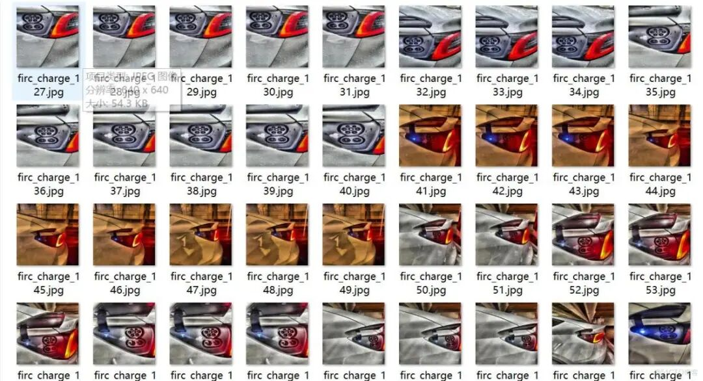
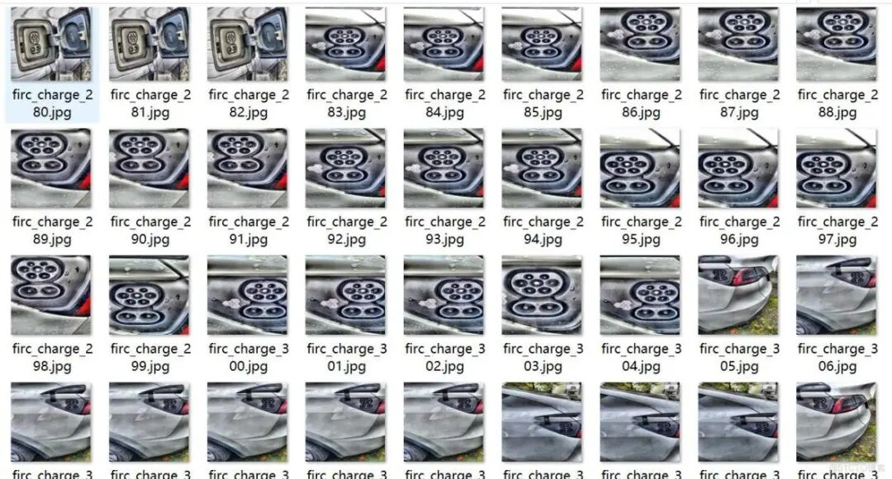
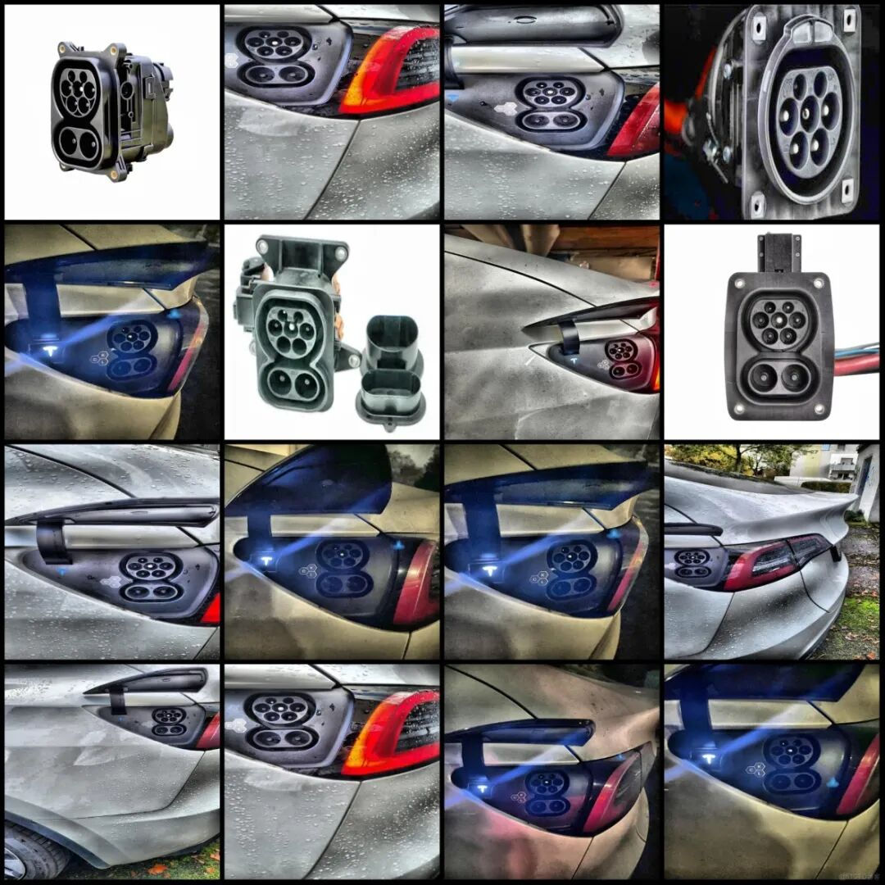
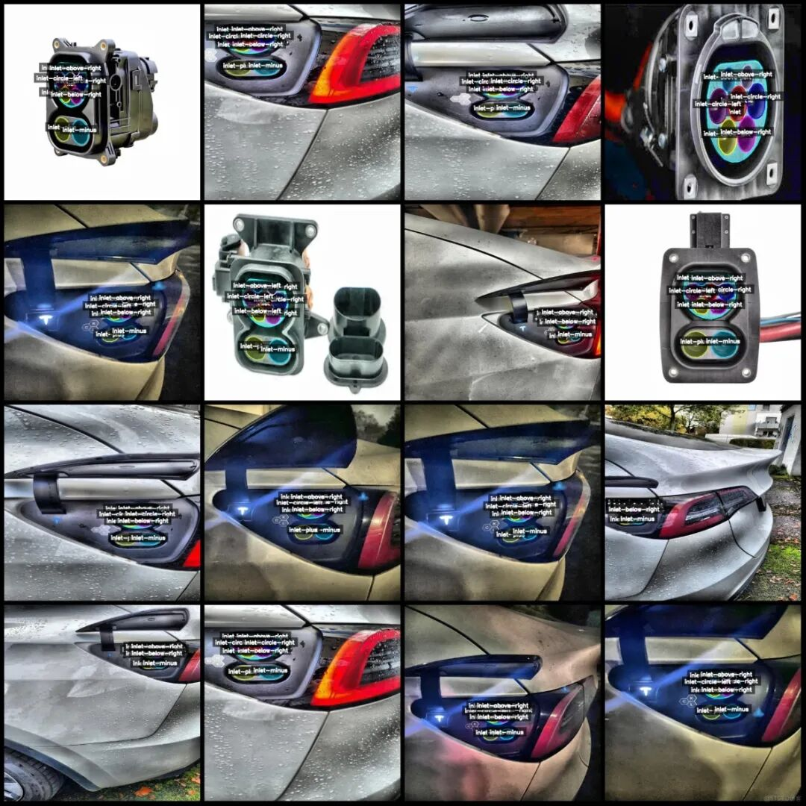
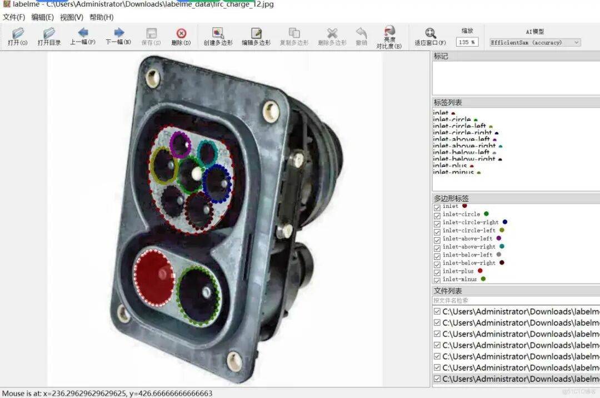

# EV Charging Port Positioning and Recognition Data Set: 363 Charger Interface Identification and Segmentation Dataset in LabelMe Format with 10 Categories

Dataset format: labelme format (without mask files, only including jpg images and corresponding json files)

Number of images (number of jpg files): 363

Number of annotations (number of json files): 363

Label category count: 10

Label category names: ["inlet", "inlet-circle", "inlet-circle-left", "inlet-circle-right", "inlet-above-left", "inlet-above-right", "inlet-below-left", "inlet-below-right", "inlet-plus", "inlet-minus"]

Number of boxes labeled in each category:

Inlet (entry) count = 363

Inlet-circle (Circle Inlet) count = 363

Inlet-circle-left (Left Circle Inlet) count = 363

inlet-circle-right (right circular inlet) count = 363

Inlet-above-left (Left Upper Inlet) count = 360

Inlet-above-right (Right Upper Inlet) count = 364

Inlet-below-left (Left bottom inlet) count = 362

Inlet-below-right (Right Low Inlet) count = 361

Inlet-plus (Positive Entry) count = 353

Inlet-minus (negative electrode inlet) count = 350

Total frame count: 3602

Using labeling tool: labelme=5.5.0

Image resolution: 640x640

Is the dataset enhanced? Yes, about 157 are original images and the rest are enhanced.

Annotation rules: Draw polygons around the categories.

Important Notice: The dataset can be opened and edited using LabelMe. For JSON datasets, one must convert them into mask or Yolo formats for semantic segmentation or instance segmentation.

Special : This dataset does not guarantee the accuracy of the trained models or weight files.

Image Preview:

Annotation example:

Original image:

Annotation:

LabelMe editing example:

## Payment

Here is a pay link on Stripe ( https://buy.stripe.com/3cs8yP7sY87d0vu9AB ). Please contact me lonlonago@foxmail.com after funding $89, and I will send you a complete data files , thank you!

